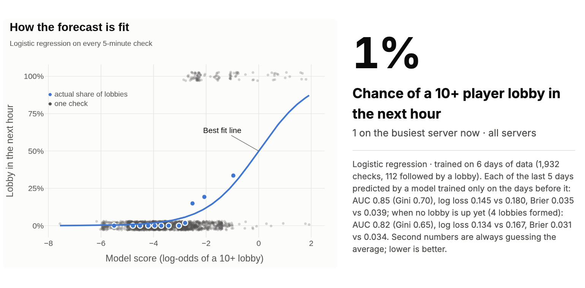

### WHEN ARE PEOPLE PLAYING BALLOON RACE????
#### No more randomly checking and hoping people are on - here is the cold hard data

##### Checks every 5 minutes, charts update every day (times in Mountain Time)

**Get pinged when a 10+ player server is going: [join the Discord](https://discord.gg/gdDVEeH7Y)**

**Website with a live "who's on now" list and server filters: https://benbav.github.io/tf2_balloon_race_forecast/**

Example of the live lobby forecast (a static screenshot - on the website it updates every 5 minutes):



### Top 5 Balloon Race servers

Ranked by how often they have people on. Favorite these so they're one click away.

<!-- TOP_SERVERS_START -->
| # | Server | Connect (paste in TF2 console) | Best time | Best day | Has players | Avg players when on | Peak |
|---|---|---|---|---|---|---|---|
| 1 | Balloon Race 24/7 | `connect 45.88.229.19:27024` | Tue · 11 AM – 1 PM MT (96%) | Sunday | 51% of checks | 1.2 | 6 |
| 2 | Server hosted by Physgun.com | `connect 45.45.238.134:27105` | Fri · 6 PM – 8 PM MT (83%) | Friday | 9% of checks | 21.8 | 23 |
| 3 | Wacky Races | `connect 169.254.226.130:52208` | Thu · 9 PM – 11 PM MT (75%) | Thursday | 2% of checks | 4.0 | 4 |
| 4 | IdleServer.Com \| BALLOON \| BALLOON_01 | `connect 108.181.244.76:48800` | Fri · 3 PM – 5 PM MT (12%) | Friday | 1% of checks | 1.0 | 1 |
| 5 | shounic trenches (USA Chicago) | `connect 193.243.190.25:27015` | Fri · 2 PM – 4 PM MT (12%) | Friday | 1% of checks | 15.4 | 48 |

To favorite one: Steam → View → Game Servers → Favorites → **+** and paste the address.
<!-- TOP_SERVERS_END -->

---

### How it works

- `main.py` runs every 5 minutes. It asks the Steam API which TF2 servers are on `balloon_race_v2b`, logs every server with human players (bots excluded) to `tf2_balloon_log.txt`. If `discord_webhook_url` is set, it posts to Discord when a server goes over `MIN_PLAYER_THRESHOLD` players.
- `index.html` is the website, served free by GitHub Pages. It shows the charts, the top servers from `charts/site_data.json`, and the live server list.
- `generate_report.py` runs once a day. It turns the log into the website's charts, rewrites the top servers table, and pushes the README and log to `main`. The page and charts go to the `site` branch as a single commit that's replaced daily, so ~16MB of charts a day doesn't pile up in the history. The log lives in `main` so its history is never lost.
- `main.py` also pushes the current server list to the `live` branch every check, the same single-commit way, for the website's "who's on now" list.

### First-time setup

**1. Install**

```bash
git clone git@github.com:benbav/tf2_balloon_race_forecast.git
cd tf2_balloon_race_forecast
python3 -m venv .venv
.venv/bin/pip install -r requirements.txt
.venv/bin/plotly_get_chrome   # headless Chrome that plotly uses to save the chart PNGs
```

**2. Create a `.env` file** in the project folder (it's gitignored, never commit it):

```bash
# Steam Web API key
steam_api_key=

# Optional: Discord channel webhook for "lobby is up" pings
discord_webhook_url=
```

Where to get each value:

| Key | Where to get it |
|---|---|
| `steam_api_key` | Sign in at https://steamcommunity.com/dev/apikey, enter any domain name (e.g. `localhost`), and copy the key. |
| `discord_webhook_url` | Optional. In Discord: channel settings (gear icon) → Integrations → Webhooks → New Webhook → Copy Webhook URL. Posts once when a server goes over `MIN_PLAYER_THRESHOLD` players, and again only after it empties out and refills. |

**3. Test it**

```bash
.venv/bin/python main.py && tail tf2_balloon_log.txt
.venv/bin/python generate_report.py --no-push   # draws charts without pushing
```

**4. Schedule it** with `crontab -e` (cron runs in the server's clock, UTC here):

```cron
*/5 * * * * cd /path/to/tf2_balloon_race_forecast && .venv/bin/python main.py >> cron.log 2>&1
0 6 * * * cd /path/to/tf2_balloon_race_forecast && .venv/bin/python generate_report.py >> cron.log 2>&1
```

The daily report pushes to GitHub, so the repo remote needs to use SSH (`git remote set-url origin git@github.com:benbav/tf2_balloon_race_forecast.git`) with a key added to your GitHub account.

**5. Turn on the website**: on GitHub, go to **Settings → Pages → Build and deployment → Deploy from a branch**, pick the `site` branch and `/ (root)` (the branch appears after the first `generate_report.py` run), and save. Free Pages needs a public repo. The site is live at `https://<user>.github.io/tf2_balloon_race_forecast/` a minute later.

### Settings

- `main.py`: `MIN_PLAYER_THRESHOLD`
- `server_types.py`: `DEDICATED_NAME_RE` / `DEDICATED_ADDRS` (which servers count as dedicated 24/7)
- `generate_report.py`: `DISPLAY_TIMEZONE` / `TZ_LABEL` (chart timezone), `LOG_TIMEZONE` (clock the log was written in), `MIN_DAYS_FOR_SCORECARD`, `SCORECARD_RECENT_DAYS`, `BUSY_THRESHOLD`, `TOP_SERVER_COUNT`
